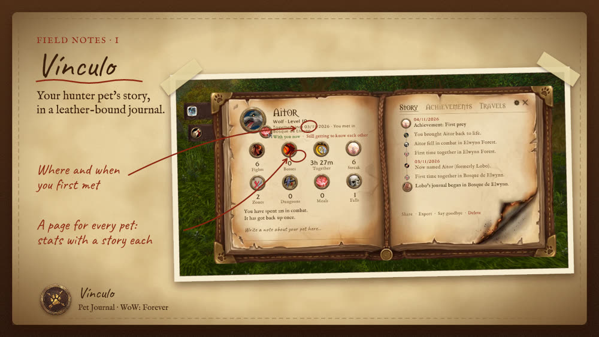
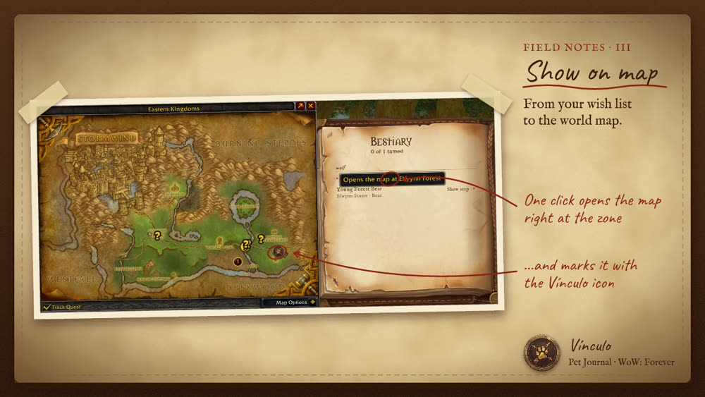

# Vínculo – Hunter Pet Journal

A leather-bound journal for your hunter pet in **World of Warcraft: Forever**. A page for every pet you have had: the day you met, the fights you survived, the zones you walked together, 21 achievements and a dated story. Plus a bestiary that shows you on the map where to tame your next beast.

**[Download on CurseForge](https://www.curseforge.com/wow/addons/vinculo-pet-journal)** · Free · MIT licensed · English and Spanish



## Features
- **Pet page**: round portrait, 8 stat medallions with a one-line story, tooltip with all 12 stats.
- **History** as a timeline, **21 achievements** as medals, **Journeys** grouped by continent.
- **Bestiary** with autocomplete for beasts and zones, a **Show map** button, a Codex of pet families and challenges.
- **Beast tooltips**: wish list, the skill it teaches, whether you own the family.
- **One-click feeding** with the best food in your bags (out of combat only).
- Achievement alerts that use the game's own banner. Everything can be turned off.
- Information only: it never tells you what to do in combat.



## Install
- **CurseForge app**: search for *Vinculo - Pet Journal*.
- **Manual**: copy the `Vinculo` folder into `World of Warcraft/_forever_/Interface/AddOns/`.

Open the journal with `/vinculo` or the minimap button. Other commands: `/vinculo toasts`, `/vinculo share`, `/vinculo export`.

## Notes
- Written in plain Lua 5.1, no libraries. SavedVariables: `VinculoDB`.
- WoW: Forever does not let addons read the combat log, so Vínculo counts **fights survived** instead of kills.
- Beast, zone, food and skill data are for Classic; Forever may have more.
- See [CHANGELOG.md](CHANGELOG.md) for known issues.

## Found a bug?
Open an issue with the exact Lua error text (turn errors on with `/console scriptErrors 1`).

## Development
Tests run outside the game with a Lua interpreter in Node:

```bash
cd _luatest && npm install && cd ..
node _luatest/run.js
```

The addon is in `Vinculo/`. Load order: Locale → Data → Zones → Skills → Foods → Core → Achievements → Extras → UI.

## Licence
MIT, see [LICENSE](LICENSE). Fonts: IM Fell English and Caveat, SIL Open Font License.

---

# Español

**Vínculo** es un diario para la mascota del cazador en **WoW: Forever**: historia, estadísticas, 21 logros, viajes por continente y un bestiario con autocompletar que te marca en el mapa dónde domesticar tu próxima bestia. Gratis, licencia MIT.

Instálalo desde [CurseForge](https://www.curseforge.com/wow/addons/vinculo-pet-journal) o copia la carpeta `Vinculo` a `_forever_/Interface/AddOns/`. Ábrelo con `/vinculo`. Si ves un error, abre un *issue* con el texto exacto del error de Lua.
